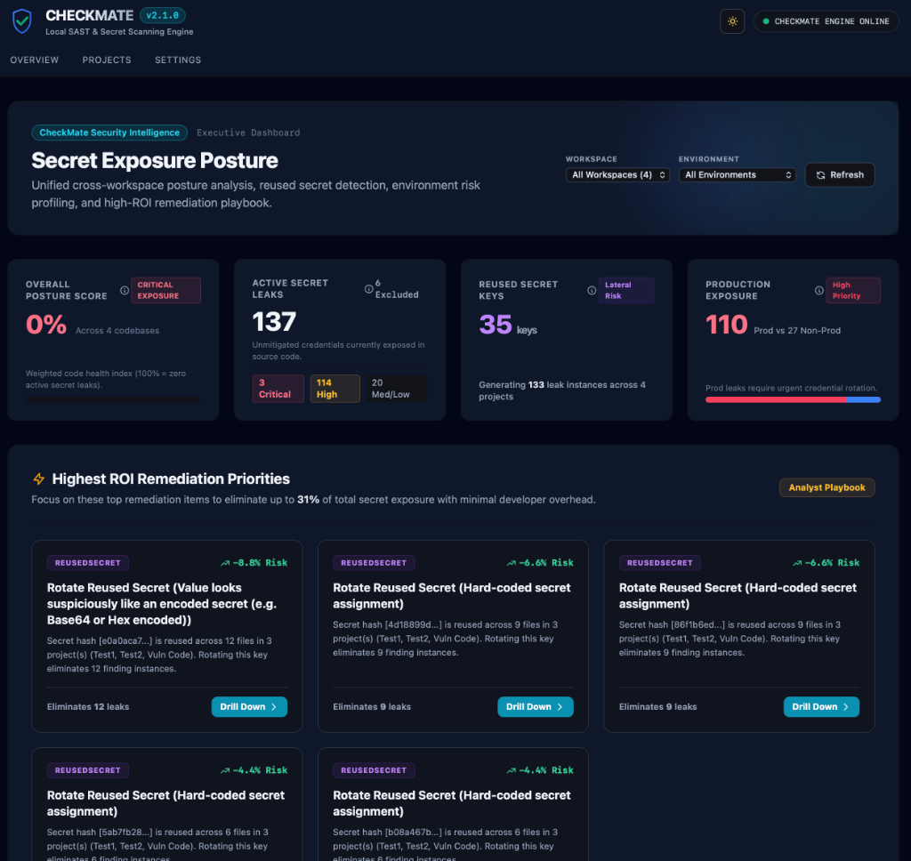

<div align="center">

# 🛡️ CheckMate App

**Local SAST & Secret Exposure Intelligence Desktop Platform**


[](https://github.com/adedayo/checkmate-app/releases)
[](https://github.com/adedayo/checkmate-app/pkgs/container/checkmate-app)
[](https://adedayo.github.io/checkmate/#desktop)
[](LICENSE)

<br/>



</div>

---

## 📌 Overview

**CheckMate App** is the native cross-platform desktop application for the CheckMate security ecosystem. Designed for security analysts, leads, and developers, it delivers a high-density, executive-level dashboard to analyze secret exposure posture across codebases, repositories, and organizational workspaces.

Unlike traditional flat security scanners, CheckMate App correlates findings across projects to identify **reused credentials**, classify **production vs. non-production leaks**, compute **highest-ROI remediation priorities**, and track **multi-scan posture trends**.

---

## ✨ Features

- 📊 **Executive & Analyst Dashboard**: Unified security posture rating (0–100%) with real-time workspace and environment filtering.
- 🤖 **Bring Your Own AI (BYO AI) Auto-Triage**: Connect local LLMs (Ollama) or cloud models (OpenAI, Anthropic, DeepSeek) for automated finding analysis, false positive likelihood scoring, and auto-suppression with persistent human-in-the-loop override memory.
- 🔐 **Authenticated Private Git Scanning (HTTPS & SSH)**: Clones private GitHub, GitLab, and self-hosted repositories via saved Git Services, environment tokens, or native SSH (`ssh-agent` / key files), verifies TLS by default, and reports clone failures explicitly instead of silent 0-finding scans.
- 🤝 **Shared Ecosystem Store (`~/.checkmate/checkmate.db`)**: Shares findings, triage verdicts, and governed exceptions directly with the CheckMate CLI, MCP server (`checkmate mcp serve`), and LSP 3.17 IDE server (`checkmate lspServe`).
- 🔑 **Cross-Project Reused Secrets Inventory**: Detects secret keys reused across multiple repositories to mitigate lateral movement risk.
- 🎯 **Highest ROI Remediation Playbook**: Ranks top 5 actions that yield the largest percentage reduction in exposure (e.g. rotating 1 reused secret key eliminates 14 leak instances).
- 🧪 **Production vs. Non-Production Risk Profiling**: Heuristically classifies leaks in live code vs. test suites, mocks, and fixtures.
- 📈 **Multi-Scan Posture Trends**: Custom interactive SVG trend charts tracking critical and high findings over historical scan executions.
- 🔄 **In-App Auto-Update Checking**: Built-in release detection that notifies analysts when a new version is available on GitHub Releases.

For full documentation across the CheckMate CLI, MCP server, LSP 3.17 server, REST API, and Desktop App, visit the [CheckMate Project Site](https://adedayo.github.io/checkmate/#desktop).

---

## 🤖 Bring Your Own AI (BYO AI) Auto-Triage & Auto-Suppression

CheckMate App includes a privacy-first **BYO AI Triage Engine** that eliminates alert fatigue without compromising code confidentiality.

### Key Capabilities
- **Multi-Provider Support:** Connect your choice of AI provider:
  - 🦙 **Ollama** (Local, air-gapped LLMs like `llama3`, `mistral`, `codellama` - zero code leaves your machine)
  - 🧠 **OpenAI** (`gpt-4o`, `gpt-4-turbo`)
  - 🤖 **Anthropic** (`claude-3-5-sonnet`, `claude-3-haiku`)
  - ⚡ **DeepSeek** (`deepseek-chat`, `deepseek-coder`)
  - 🔌 **Custom OpenAI-Compatible Endpoints** (vLLM, LocalAI, LM Studio)
- **Automated Triage & Confidence Thresholding:** Analyzes finding entropy, structural context, and code evidence. When a finding exceeds your configured confidence threshold (e.g., `fpLikelihood >= 80%`), CheckMate automatically creates an exception record and suppresses the finding.
- **Privacy & Prompt Redaction:** Choose between **`REDACTED`** mode (masks sensitive credentials before sending to LLM) or **`FULL`** context mode.
- **Human-in-the-Loop & Decision Memory:**
  - Analysts can view detailed AI annotations, confidence scores, and reasoning summaries in the finding detail drawer.
  - If an analyst marks a finding as **"True Positive"** or deletes an AI-generated suppression, CheckMate flags the finding with `UserOverridden = true`.
  - CheckMate's persistent database remembers your decision across future scan runs: **the AI engine will NEVER re-suppress a user-confirmed finding on subsequent scans**.

---

## 🚀 Quick Start & Installation

### 🍏 macOS (Apple Silicon & Intel)

#### Option 1: Homebrew Cask (Recommended)
```bash
brew install --cask adedayo/tap/checkmate-app
```

> [!NOTE]
> **macOS Gatekeeper.** CheckMate is free open-source software and is not
> code-signed with a paid Apple Developer certificate - we are not going to
> charge the community, however indirectly, to fund a $99/year rent to Apple.
> The Homebrew cask above verifies the download's SHA-256 and clears the
> quarantine flag for you, so **this route needs no workaround**.
>
> If you download the `.dmg` directly, macOS will say Apple "cannot check it".
> Verify it yourself against `SHA256SUMS` (see
> [docs/distribution.md](docs/distribution.md)), drag the app into
> `/Applications`, then clear the flag on that one app:
> ```bash
> xattr -dr com.apple.quarantine /Applications/CheckMate.app
> ```
> It has to be done after the drag. The copy inside the mounted disk image is
> on a read-only volume, so `xattr` there fails with `Read-only file system`.
>
> If that command answers `Operation not permitted` for every file, macOS App
> Management protection is guarding the installed bundle. Either run it with
> `sudo`, or grant your terminal **Privacy & Security → App Management** and
> retry, or simply right-click the app in Finder and choose **Open**.
>
> All of these are scoped to this app. Do not run `spctl --master-disable`,
> which disables Gatekeeper for everything you will ever download.

#### Option 2: Direct Download
Download the latest `.dmg` or `.zip` release from [GitHub Releases](https://github.com/adedayo/checkmate-app/releases/latest).

---

### 🪟 Windows

#### Option 1: Native Installer
Download and run `CheckMate-amd64-installer.exe` from [GitHub Releases](https://github.com/adedayo/checkmate-app/releases/latest).

#### Option 2: Winget
```cmd
winget install adedayo.checkmate-app
```

---

### 🐧 Linux

Download the Linux package from [GitHub Releases](https://github.com/adedayo/checkmate-app/releases/latest):
```bash
# Extract the binary
tar -xzvf CheckMate-linux-amd64.tar.gz

# Run the app
./CheckMate
```

---

### 🐳 Docker Container (One-Liner Deployment)

Run CheckMate App in headless/web mode with a single command:

```bash
docker run -d \
  --name checkmate-app \
  -p 8080:8080 \
  -v ~/.checkmate:/root/.checkmate \
  ghcr.io/adedayo/checkmate-app:latest
```

Access the UI in your browser at `http://localhost:8080`.

#### Docker Compose
Alternatively, launch using Docker Compose:

```yaml
version: '3.8'
services:
  checkmate-app:
    image: ghcr.io/adedayo/checkmate-app:latest
    container_name: checkmate-app
    ports:
      - "8080:8080"
    volumes:
      - ~/.checkmate:/root/.checkmate
```

```bash
docker compose up -d
```

---

## 🔄 Auto-Update Mechanism

CheckMate App automatically checks the [GitHub Releases](https://api.github.com/repos/adedayo/checkmate-app/releases/latest) on startup. When a new release is published:

1. An **Update Ready Banner** appears at the top of the Executive Dashboard.
2. Displays the version jump (e.g., `v2.1.0` ➔ `v2.2.0`) and release notes summary.
3. Provides a 1-click **Get Update** button linking directly to the release package.

---

## 🛠️ Maintainer Release & Tagging Process

Automated multi-platform builds (macOS DMG, Windows EXE, Linux packages, Docker images) are governed by GitHub Actions (`.github/workflows/release.yml`).

To trigger an automated release:

```bash
# Run the automated release orchestration script
./scripts/release.sh v2.4.1
```

This script will:
1. Validate semver formatting (`v2.4.1`) and verify a clean, synchronised `main` tree without `go.work` or `replace` directives.
2. Run `./test.sh` (Go tests, `prosecheck`, Angular unit tests, packaging validation) and verify frontend & Go builds.
3. Bump `frontend/package.json` and `wails.json` (`pkg/version.Version` is stamped via `-ldflags` at release build time).
4. Commit the version bump, create an annotated git tag (`v2.4.1`), and push to `origin`, triggering the GitHub Actions matrix build.

See [RELEASING.md](RELEASING.md) for full details.

---

## 💻 Local Development Setup

### Prerequisites
- **Go**: `1.26.6+`
- **Node.js**: `24+` & `npm`
- **Wails CLI**: `go install github.com/wailsapp/wails/v2/cmd/wails@latest`

### Running Development Server
```bash
# Clone checkmate-app repository
git clone https://github.com/adedayo/checkmate-app.git
cd checkmate-app

# Launch Wails development environment (Hot Reloading)
wails dev
```

---

## 📜 License

CheckMate App is open-source software licensed under the [BSD 3-Clause License](LICENSE).
